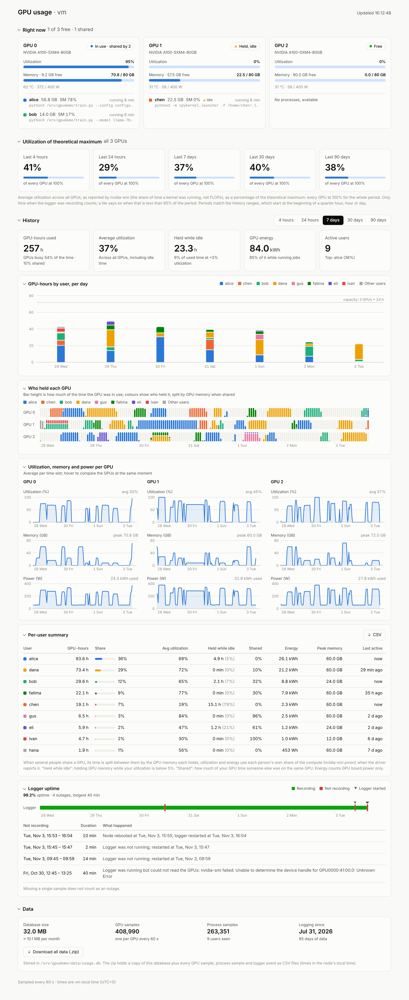

# gpu-dashboard

Per-user GPU usage logging and a web dashboard for a single shared GPU node, for labs
without Slurm. It needs **no root and no installs**: one Python file, the standard
library, and `nvidia-smi`.



## What it shows

- **Right now**: each GPU is marked free, in use, shared or "held, idle". The cards show
  utilization, used and free memory, temperature, and power against the power limit, plus
  every process with its user, memory, its own compute (SM) use, running time and command.
- **Utilization of theoretical maximum**: one number for all GPUs together, for each of
  the last 4 hours, 24 hours, 7, 30 and 90 days.
- **History** for the last 4 hours, 24 hours, 7, 30 or 90 days:
  - GPU-hours per user over time.
  - Who held each GPU when, including sharing.
  - Utilization, memory and power per GPU.
  - A per-user summary: GPU-hours, share of use, average utilization, time spent holding
    a GPU while idle, time spent sharing, energy (kWh), peak memory and last activity.
  - **Logger uptime**: when samples were being recorded, plus each outage and its likely
    cause.
- **Data**: database size, sample counts, growth per month, and downloads of everything
  recorded.

Every section and chart can be folded away by clicking its title. Your browser remembers
which ones you folded.

## Setup (no sudo)

Pick a folder for the data. A local disk such as a scratch directory is best, because
SQLite works less well on network home directories. The examples below use
`/path/to/scratch/gpu-dash`; replace it with your own path.

1. **Get the code** on the GPU node:

   ```bash
   git clone https://github.com/TheRootOf3/gpu-dashboard ~/gpu-dashboard
   ```

2. **Check that you can see other people's jobs.** Run these while someone else has a job
   on a GPU. Their process IDs should appear in both:

   ```bash
   nvidia-smi --query-compute-apps=pid,used_memory --format=csv
   ```

   ```bash
   nvidia-smi pmon -c 1 -s u
   ```

   If `pmon` fails (for example on MIG GPUs), the dashboard still works, but it falls
   back to whole-GPU utilization (see [Shared GPUs](#shared-gpus)).

3. **Start it once by hand.** This creates the data folder:

   ```bash
   python3 ~/gpu-dashboard/gpu_dash.py --data-dir /path/to/scratch/gpu-dash
   ```

4. **Keep it running with your own crontab.** Open it:

   ```bash
   crontab -e
   ```

   Add this line:

   ```
   */5 * * * * /usr/bin/python3 $HOME/gpu-dashboard/gpu_dash.py --data-dir /path/to/scratch/gpu-dash >> /path/to/scratch/gpu-dash/gpu_dash.log 2>&1
   ```

   Every 5 minutes cron starts the dashboard if it isn't running, which also covers
   reboots. A second copy notices the first and exits straight away. Cron picks up the
   line as soon as you save it, so nothing else needs starting. If `crontab` isn't
   allowed for your account, run the command from step 3 inside `tmux` instead.

5. **Open the dashboard** from your laptop through an SSH tunnel, replacing
   `user@gpu-node` with your login and the node's address:

   ```bash
   ssh -N -L 8050:localhost:8050 user@gpu-node
   ```

   Then go to <http://localhost:8050>. Anyone with SSH access to the node can do the
   same. To serve it on the network without a tunnel, add `--host 0.0.0.0`. Be aware
   that the page has no login and shows usernames and command lines.

To avoid typing `--data-dir` for the commands below, add this line to your `~/.bashrc`:

```bash
export GPU_DASH_DIR=/path/to/scratch/gpu-dash
```

## Command line

| Command | What it does |
|---|---|
| `gpu_dash.py` | Records a sample every 60 s and serves the dashboard on `127.0.0.1:8050` |
| `gpu_dash.py --report 7d` | Prints the per-user summary, utilization of the theoretical maximum and logger uptime, for `4h`, `24h`, `7d`, `30d` or `90d` |
| `gpu_dash.py --report 30d --csv` | Prints the per-user summary as CSV |
| `gpu_dash.py --export DIR` | Writes the same zip as **Download all data** into `DIR` |

Options: `--data-dir DIR` (default `$GPU_DASH_DIR`, otherwise `~/.gpu-dash`), `--port`
(default 8050), `--host` (default 127.0.0.1), `--interval` (seconds between samples,
default 60).

## Exporting data

**Download all data (.zip)** in the **Data** section of the page, and `--export DIR` on
the command line, both produce `gpu-usage-export_<host>_<date>.zip`. It contains:

| File | Contents |
|---|---|
| `gpu-usage_<host>_<date>.sqlite` | The whole database, copied safely while logging continues |
| `gpu-samples_<host>_<date>.csv` | One row per GPU per sample: `time, unix_time, gpu, util_pct, mem_used_mib, mem_total_mib, power_w, temp_c, sample_seconds` |
| `process-samples_<host>_<date>.csv` | One row per GPU process per sample: `time, unix_time, gpu, user, pid, mem_mib, sm_util_pct` |
| `logger-events_<host>_<date>.csv` | Logger starts (with the node's boot time) and failed samples: `time, unix_time, event, detail` |

The CSV files are read from the same database copy, so everything in the zip agrees.
Times in them are the node's local time.

The **CSV** button above the per-user table downloads just that table for the selected
range (`user-summary-<range>_<host>_<date>.csv`).

For scripts, each file is also available on its own: `/export/usage.sqlite`,
`/export/gpu.csv`, `/export/proc.csv`, `/export/events.csv` and
`/export/summary.csv?range=7d`. The whole zip is at `/export/all.zip`.

## Utilization of theoretical maximum

For each period, this is the average utilization across all GPUs as a percentage of
the theoretical maximum, meaning every GPU at 100% for the whole period. The utilization
is the figure `nvidia-smi` reports: the share of time a kernel was running on the GPU,
not a measure of FLOPs. Only time when the logger was recording counts. When that is
less than 95% of the period, for example in the first days after setup, the tile shows
how much of the period was logged. The periods match the History ranges: the last
4 hours start at a quarter hour, the last 24 hours at the beginning of an hour, and the
7, 30 and 90 days at midnight.

## Logger uptime

The uptime chart shows when samples were recorded (green) and when they weren't (red),
with a ▼ wherever the logger started. Missing a single sample isn't counted as an outage.
Each outage is listed with its likely cause:

- **Node rebooted**: the logger started again after a gap, and the node's boot time falls
  inside the gap.
- **Logger was not running**: the logger restarted after a gap without a reboot, for
  example when cron brought it back after it was killed.
- **nvidia-smi failed**: the logger kept running but couldn't read the GPUs. The error
  message is shown.

## Shared GPUs

When several people use one GPU at the same moment:

- **GPU-hours** are split by the GPU memory each person holds, because memory is what
  stops others from fitting on the GPU. Someone holding 60 GB next to someone with 20 GB
  gets ¾ of that time. If memory isn't reported, the time is split evenly. A GPU's hours
  never add up to more than the time that actually passed.
- **Utilization** in the per-user table uses each person's own compute share (the SM %
  from `nvidia-smi pmon`), not the whole GPU's. A notebook left idle next to someone's
  training run therefore counts as idle and shows up under **Held while idle**.
- **Energy** is the GPU's power draw split by each person's compute share. If `pmon`
  can't see the processes, it is split by memory instead.
- **Shared** in the per-user table is the share of a person's GPU time that someone else
  was on the same GPU. The live cards say "shared by N", and the timeline stacks each
  person's part of the bar.

If `pmon` isn't available, per-user utilization and idle time fall back to the whole
GPU's numbers.

## Storage

All data lives in a single SQLite file, `<data-dir>/usage.db`. It grows by roughly
10 MB a month for 3 busy GPUs; the page shows the actual size and growth. A database
from an earlier version is upgraded automatically the first time a new version opens
it, and nothing is lost. Samples recorded before power logging existed simply have no
power or energy figures.

| Table | One row per |
|---|---|
| `gpu` | GPU per sample: utilization, memory, power, temperature |
| `proc` | GPU process per sample: user, pid, memory, SM utilization |
| `users` | User, with the time they were first seen (this sets their colour) |
| `events` | Logger start or failed sample (at most one failure row per 10 minutes) |

## Caveats

- **Docker**: jobs inside containers count under the user the container runs as, often
  `root`. Have people run containers with `docker run --user $(id -u)`.
- **Hidden processes**: if `/proc` is mounted with `hidepid`, owners can't be read and
  show as `(unknown)`.
- **Energy** covers GPU board power only, not CPUs, memory or cooling.
- **Sampling**: it records once per sampling interval, so jobs shorter than about a
  minute may be missed.

## Development

The tests use a fake `nvidia-smi` (`tests/fake_bin/nvidia-smi`), so no GPU is needed:

```bash
python3 -m unittest -v
```

To try the dashboard with made-up history (95 days, 9 users, shared GPUs, idle
notebooks and a few outages):

```bash
python3 dev/seed_demo.py /tmp/gpu-demo
```

```bash
PATH="$PWD/tests/fake_bin:$PATH" python3 gpu_dash.py --data-dir /tmp/gpu-demo
```
